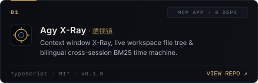
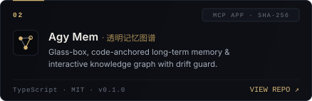
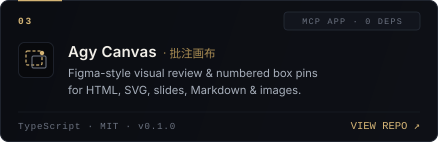
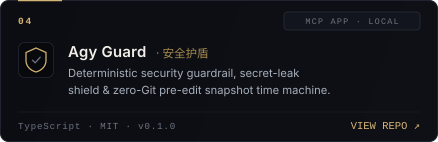
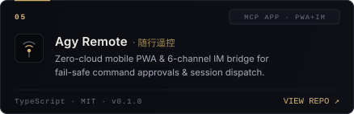
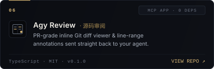
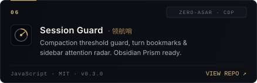
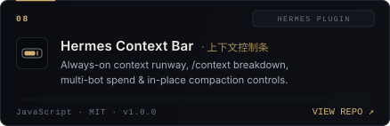

  <picture>
    <source media="(prefers-color-scheme: dark)" srcset="./assets/hero-dark.svg" />
    <source media="(prefers-color-scheme: light)" srcset="./assets/hero-light.svg" />
    
  </picture>

 

  <picture>
    <source media="(prefers-color-scheme: dark)" srcset="./assets/div-01-dark.svg" />
    <source media="(prefers-color-scheme: light)" srcset="./assets/div-01-light.svg" />
    
  </picture>

  <a href="https://github.com/tone-leh/agy-xray"><picture><source media="(prefers-color-scheme: dark)" srcset="./assets/card-agy-xray-dark.svg" /><source media="(prefers-color-scheme: light)" srcset="./assets/card-agy-xray-light.svg" /></picture></a>&nbsp;
  <a href="https://github.com/tone-leh/agy-mem"><picture><source media="(prefers-color-scheme: dark)" srcset="./assets/card-agy-mem-dark.svg" /><source media="(prefers-color-scheme: light)" srcset="./assets/card-agy-mem-light.svg" /></picture></a>

  <a href="https://github.com/tone-leh/agy-canvas"><picture><source media="(prefers-color-scheme: dark)" srcset="./assets/card-agy-canvas-dark.svg" /><source media="(prefers-color-scheme: light)" srcset="./assets/card-agy-canvas-light.svg" /></picture></a>&nbsp;
  <a href="https://github.com/tone-leh/agy-guard"><picture><source media="(prefers-color-scheme: dark)" srcset="./assets/card-agy-guard-dark.svg" /><source media="(prefers-color-scheme: light)" srcset="./assets/card-agy-guard-light.svg" /></picture></a>

  <a href="https://github.com/tone-leh/agy-remote"><picture><source media="(prefers-color-scheme: dark)" srcset="./assets/card-agy-remote-dark.svg" /><source media="(prefers-color-scheme: light)" srcset="./assets/card-agy-remote-light.svg" /></picture></a>&nbsp;
  <a href="https://github.com/tone-leh/agy-review"><picture><source media="(prefers-color-scheme: dark)" srcset="./assets/card-agy-review-dark.svg" /><source media="(prefers-color-scheme: light)" srcset="./assets/card-agy-review-light.svg" /></picture></a>

  <a href="https://github.com/tone-leh/agy-session-guard"><picture><source media="(prefers-color-scheme: dark)" srcset="./assets/card-agy-session-guard-dark.svg" /><source media="(prefers-color-scheme: light)" srcset="./assets/card-agy-session-guard-light.svg" /></picture></a>

 

  <picture>
    <source media="(prefers-color-scheme: dark)" srcset="./assets/div-02-dark.svg" />
    <source media="(prefers-color-scheme: light)" srcset="./assets/div-02-light.svg" />
    
  </picture>

  <a href="https://github.com/tone-leh/hermes-context-bar"><picture><source media="(prefers-color-scheme: dark)" srcset="./assets/card-hermes-context-bar-dark.svg" /><source media="(prefers-color-scheme: light)" srcset="./assets/card-hermes-context-bar-light.svg" /></picture></a>&nbsp;
  <a href="https://github.com/tone-leh/stickypatch"><picture><source media="(prefers-color-scheme: dark)" srcset="./assets/card-stickypatch-dark.svg" /><source media="(prefers-color-scheme: light)" srcset="./assets/card-stickypatch-light.svg" /></picture></a>

 

  <picture>
    <source media="(prefers-color-scheme: dark)" srcset="./assets/colophon-dark.svg" />
    <source media="(prefers-color-scheme: light)" srcset="./assets/colophon-light.svg" />
    
  </picture>

