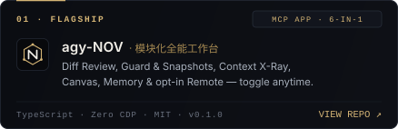
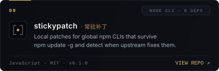

  <picture>
    <source media="(prefers-color-scheme: dark)" srcset="./assets/hero-dark.svg" />
    <source media="(prefers-color-scheme: light)" srcset="./assets/hero-light.svg" />
    
  </picture>

 

  <picture>
    <source media="(prefers-color-scheme: dark)" srcset="./assets/div-01-dark.svg" />
    <source media="(prefers-color-scheme: light)" srcset="./assets/div-01-light.svg" />
    
  </picture>

  <a href="https://github.com/tone-leh/agy-NOV"><picture><source media="(prefers-color-scheme: dark)" srcset="./assets/card-agy-nov-dark.svg" /><source media="(prefers-color-scheme: light)" srcset="./assets/card-agy-nov-light.svg" /></picture></a>&nbsp;
  <a href="https://github.com/tone-leh/agy-session-guard"><picture><source media="(prefers-color-scheme: dark)" srcset="./assets/card-agy-session-guard-dark.svg" /><source media="(prefers-color-scheme: light)" srcset="./assets/card-agy-session-guard-light.svg" /></picture></a>

 

  <picture>
    <source media="(prefers-color-scheme: dark)" srcset="./assets/div-02-dark.svg" />
    <source media="(prefers-color-scheme: light)" srcset="./assets/div-02-light.svg" />
    
  </picture>

  <a href="https://github.com/tone-leh/hermes-context-bar"><picture><source media="(prefers-color-scheme: dark)" srcset="./assets/card-hermes-context-bar-dark.svg" /><source media="(prefers-color-scheme: light)" srcset="./assets/card-hermes-context-bar-light.svg" /></picture></a>&nbsp;
  <a href="https://github.com/tone-leh/stickypatch"><picture><source media="(prefers-color-scheme: dark)" srcset="./assets/card-stickypatch-dark.svg" /><source media="(prefers-color-scheme: light)" srcset="./assets/card-stickypatch-light.svg" /></picture></a>

 

  <picture>
    <source media="(prefers-color-scheme: dark)" srcset="./assets/colophon-dark.svg" />
    <source media="(prefers-color-scheme: light)" srcset="./assets/colophon-light.svg" />
    
  </picture>

